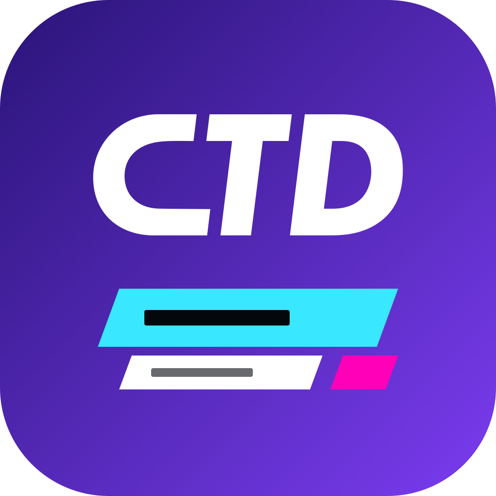
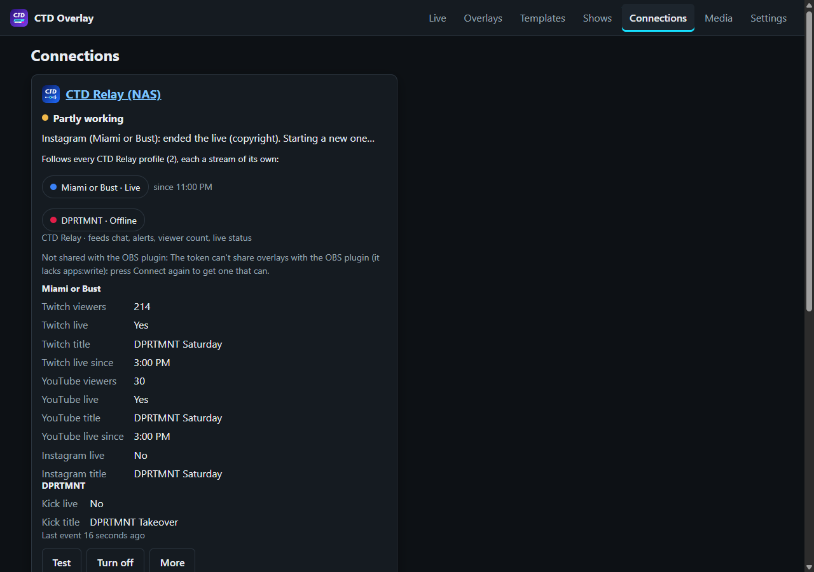
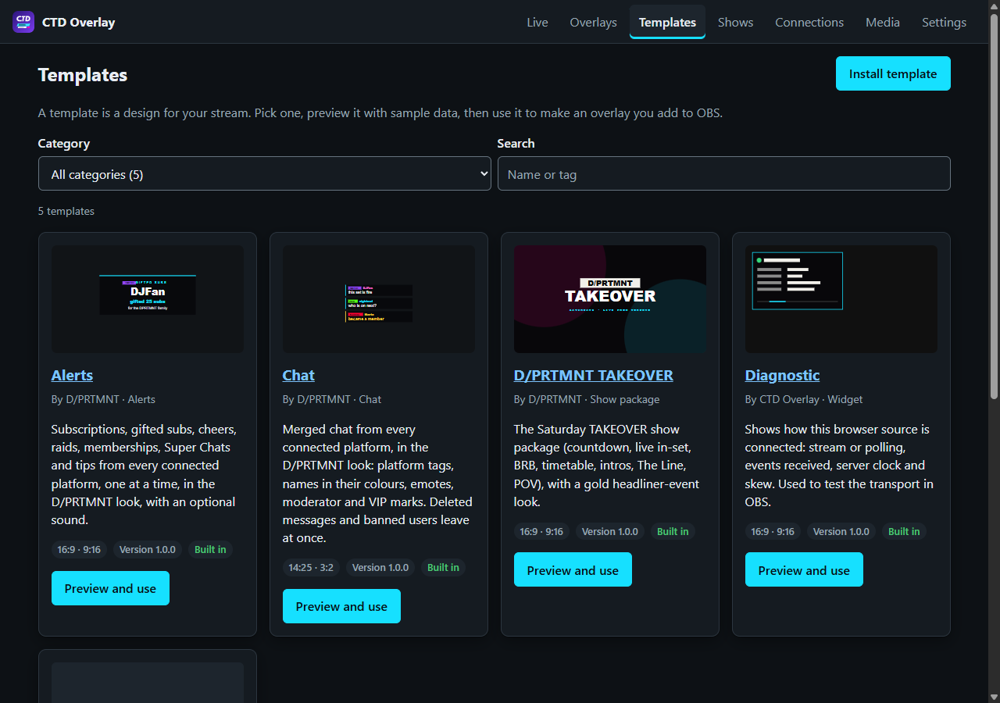
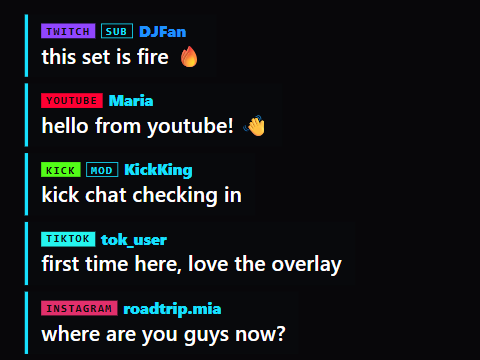
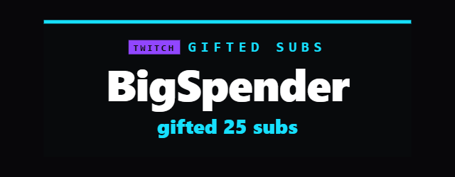
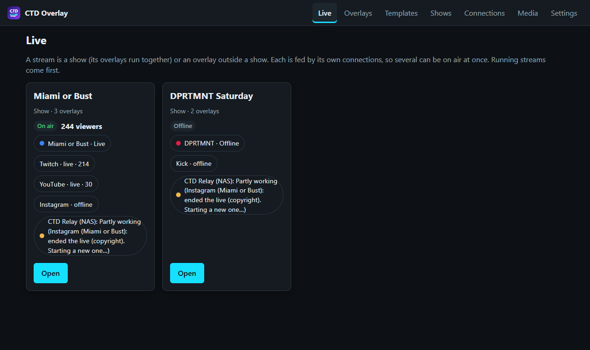
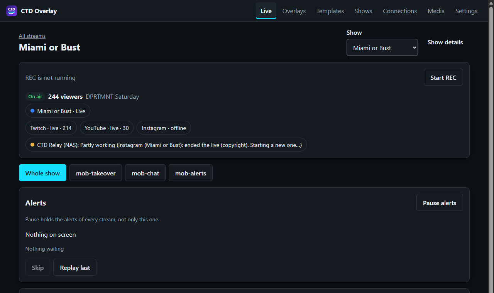
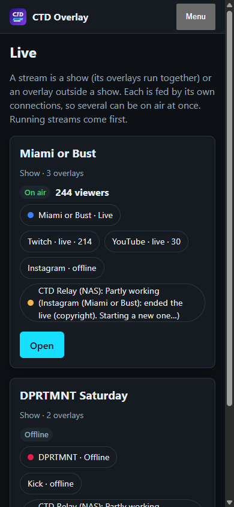
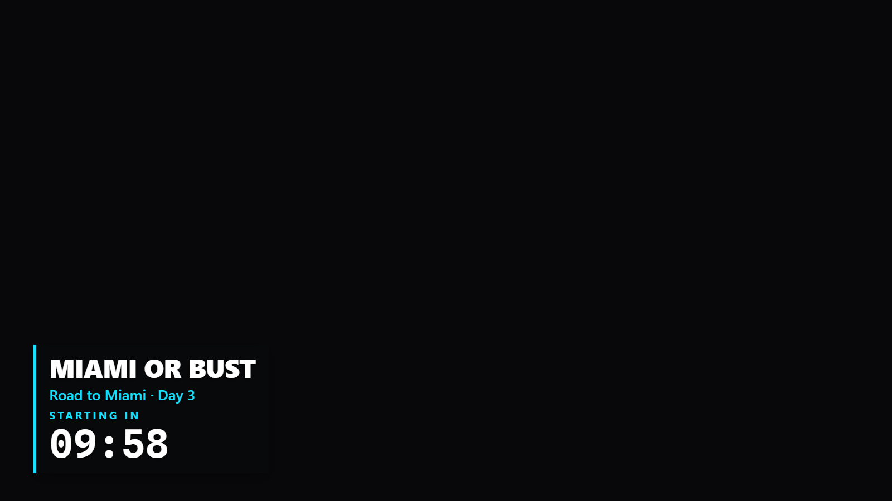

<p align="center">
  
</p>

<h1 align="center">The CTD Overlay guide</h1>

<p align="center">How it all fits together, from first start to show night.<br>
For exact settings and fixes, see <a href="RUNNING.md">RUNNING.md</a>.</p>

---

## 1. The big picture

Three apps work together. You stream through **CTD Relay**, **CTD Overlay** draws the graphics, and
**OBS** shows them.

```
 Twitch · YouTube · Kick · TikTok · Instagram · Facebook · X
                          ▲  (your stream goes out)
                          │  (chat, alerts, viewers come back)
                ┌─────────┴─────────┐
                │     CTD Relay     │  profiles: "Miami or Bust", "DPRTMNT", …
                └─────────┬─────────┘
       chat, alerts,      │      ▲  which overlays each profile has
       viewers, clock,    │      │
       OBS scenes         ▼      │
                ┌───────────────────┐
                │    CTD Overlay    │  overlays, shows, the Live console
                └─────────┬─────────┘
                          │  overlay links (browser sources)
                          ▼
                ┌───────────────────┐
                │  OBS + CTD plugin │  tells Relay which scene is on air
                └───────────────────┘
```

- **CTD Relay** streams to every platform at once and merges what comes back: chat, alerts,
  viewer counts and live status. It is also the hub the apps find each other through.
- **CTD Overlay** turns that into graphics (chat boxes, alerts, countdowns, whole show packages)
  and runs the show: scenes, timers and lineups.
- **OBS** shows each overlay as a browser source. The **CTD OBS plugin** adds those sources for
  you, and tells Relay which scene is on air so the overlays can follow it.

## 2. The words you'll see

| Word | What it means |
|---|---|
| **Profile** | One streaming set-up in CTD Relay (its own accounts, destinations and chat), e.g. *Miami or Bust* or *DPRTMNT*. Profiles can be live at the same time. |
| **Connection** | CTD Overlay's link to a service. One **CTD Relay** connection follows **every** profile. |
| **Template** | A design: Chat, Alerts, TAKEOVER, Text & Clock, or your own like Miami or Bust. |
| **Overlay** | One copy of a template with your settings, with its own link for OBS. |
| **Fed by** | Which profile (or profiles) an overlay listens to: its chat, alerts and viewers come only from there. |
| **Show** | A group of overlays that change together, such as the horizontal and vertical TAKEOVER. A show has scenes, a lineup and a timeline. |
| **Stream** | What the **Live** page shows a card for: a show, or an overlay on its own. |
| **Scene** | What a show is showing right now: *Starting soon*, *Live*, *BRB*, *Ending*… |

## 3. Set up once

1. **Run it** on your NAS (TrueNAS app, image `ghcr.io/itslimitlezz/ctd-overlay:latest`) or on
   the PC with OBS (`npm start`). See [RUNNING.md § A and B](RUNNING.md#a-on-the-pc-that-runs-obs-windows-macos-linux).
2. **Create the owner:** the first start prints a setup code in the log. Open CTD Overlay, enter
   the code, and choose your name and password. Then turn on **two-factor** (Settings → Account).
3. **Connect CTD Relay:** **Connections → CTD Relay → Set up**, enter Relay's LAN address, and
   press **Connect**. A code appears; approve it in **CTD Relay → Settings → API** and choose
   **every profile**. Each profile then shows on the connection's card with its status.

   

4. *(Optional)* **Connect GitHub**, if a template comes from a private repository: **Settings →
   Integrations → GitHub**, paste a read-only token. See
   [RUNNING.md](RUNNING.md#templates-from-a-private-github-repository).

## 4. Build a stream

1. **Pick templates.** **Templates** shows what's installed, each with a sample preview.
   **Install template** adds more, from a file, a link or a GitHub release.

   

2. **Make overlays.** In **Overlays → New overlay**, pick a template and a name (e.g. *mob-chat*,
   *mob-alerts*, *mob-takeover*).
3. **Choose what feeds each overlay.** On the overlay's **Settings → Fed by**, choose **Only these**
   and tick the profile (*Relay · Miami or Bust*). The overlay now shows only that profile's chat,
   alerts and viewers.
4. **Group them into a show.** On a TAKEOVER overlay's page, **Make a show from this overlay**
   (or **Shows → New show**, with any overlays): the date, the time zone and when it goes live,
   with its vertical twin ticked. Then the show's **Lineup**, each act with its set time. Set
   times, the countdown, who's on, REC and title cards live on the show, so an overlay in no show
   says so and shows none of them. The show's scenes change every member at once, and a new show
   starts on **Auto**: the countdown, then live at go-live.
5. **Put them in OBS:**
   - **With the CTD OBS plugin:** pick the profile in the plugin, and it adds that profile's
     overlays as browser sources on the right canvas (main or vertical).
   - **By hand:** copy each overlay's URL from its page into an OBS **Browser** source, at the
     size the page shows.
   - **A source per scene:** under **Add to OBS**, *A URL for one scene* gives a URL that always
     shows one scene (BRB, Starting Soon…), whatever the show takes, its chat, alerts and
     lineup still live. Use it when OBS switches scenes itself and each OBS scene has its own
     source.

| Overlay | Size in OBS |
|---|---|
| Chat | 560 × 1000 (side column) or 1080 × 720 (vertical) |
| Alerts, TAKEOVER, Text & Clock | 1920 × 1080, or 1080 × 1920 for vertical |

<table>
  <tr>
    <td align="center"><br><sub>Chat, every platform tagged</sub></td>
    <td align="center"><br><sub>Alerts, one at a time</sub></td>
  </tr>
</table>

## 5. Two streams at once

Each Relay profile is its own stream. For example:

| Stream | Show | Overlays | Fed by |
|---|---|---|---|
| Miami or Bust | *Miami or Bust* | mob-takeover, mob-chat, mob-alerts | Relay · Miami or Bust |
| DPRTMNT | *DPRTMNT Saturday* | dprtmnt-takeover, dprtmnt-chat | Relay · DPRTMNT |

Both can be on air together. Chat, alerts and viewer counts never cross over, and a problem on
one profile (Instagram ending its live) only shows on that stream's card.

For a show where every overlay should come from the same profile, set **Fed by** for all its
overlays at once from the show's **Details** page.

## 6. Show night

### The Live page

**Live** opens on a card for every stream:
- **On air**, **Offline** or **Unknown**;
- each platform with its viewers, and the total;
- the connection's health in plain words, REC, and what OBS is showing.

Streams that are running come first.



**Open** a stream for its console:
- **Scenes:** one tap changes every overlay of the show, horizontal and vertical together.
  A timed scene returns by itself.
- **Who's on and the timeline:** the lineup, the next cue, and the cues that fire on their own.
  **Next act** wins over the set times: an act put on early skips what was still to come for the
  acts before, and Live says how many. **Nobody on** names no act.
- **Actions:** the template's buttons, each saying what it did: TAKEOVER's **DJ title card** and
  **Now playing** are **on air** for their seconds on screen, **Now playing (hold)** is **on air
  until hidden** (until **Hide title card and now playing**: **hidden**), **Play The Line's
  clip** is **sent** and **Stop The Line's clip** **stopped**. A button that shows nothing with
  the overlay's settings (TAKEOVER's chips outside its event look) says so, and why.
- **REC:** starts by itself at go-live, or by hand. A reset stays reset, a platform update after
  the show included.
- **The overlay picker:** pick one overlay to see its preview, its OBS link, its actions,
  **Simulate** buttons, and what feeds it.
- **Alerts:** what's on screen and what's waiting, with **Skip**, **Replay last** and **Pause**.



On a phone, it all works one-handed:



Live also says, quietly, what to put right before the night:
- **An overlay in no show** (a TAKEOVER one) says so on its card, with **Make a show from this
  overlay** and **Add it to a show** (first, and named, when a show is plainly its: the one its
  twin is in, or one with a lineup and no overlays yet): its title cards have no act to name
  until it is in one.
- **An older template version:** an overlay still on an older version than the one installed
  (after a platform update, say) has a line under its stream's status, linking to its Version
  tab. Upgrade a show's overlays of that template together, before going live; once it is live,
  after the show.

The whole TAKEOVER night, step by step, is in
[RUNNING.md](RUNNING.md#the-dprtmnt-takeover-night).

### Alerts

Alerts wait their turn on the server, so a burst never piles up:
- **Order:** raids first, then Super Chats and tips, gifts, subs, memberships, cheers, and follows
  last.
- **Gift bursts:** a gift of 25 subs (with the 25 single gifts Twitch sends after it) plays as
  **one** alert.

### Following OBS scenes

The show's graphics can switch when OBS does: OBS on **BRB** puts the overlays on *Be Right Back*.
- **Set it up:** **Shows → the show → Details → Follow OBS**, tick **Follow OBS scenes**, then
  choose a show scene for each OBS scene.
- **Which canvas:** landscape drives the show, unless the show is vertical only.
- **Your buttons still win:** a scene you take stays until OBS changes again.
- **Needs:** CTD Relay v1.5 or newer, and the CTD OBS plugin with scene publishing.

### Test before going live

- **Simulate** on an overlay sends a sample chat line, follow, sub, 25 gifted subs, raid, cheer or
  tip to that overlay only.
- Start a **test stream** in CTD Relay to see real chat arrive with its platform tags.

## 7. Templates

| Template | What it is |
|---|---|
| **Chat** | Merged chat from every platform, with platform tags, badges, emotes and name colours. Instagram/TikTok "joined" lines stay out unless you turn them on in the connection. |
| **Alerts** | Subs, gifts, raids, cheers, Super Chats and tips, one at a time, with an optional sound. |
| **TAKEOVER** | The D/PRTMNT show package: countdown, live set, BRB, timetable, intros, The Line, POV, with title cards, Now playing (held until hidden) and The Line's clip on a tap. |
| **Text & Clock** | Up to three lines of text and a clock: time of day, a countdown (showing "LIVE" at zero), a count-up, the stream's run time from Relay, or a frame-accurate timecode. |



- **Your own templates:** the [template kit](template-kit/TEMPLATE-GUIDE.md) explains how to build
  one, and has a prompt you can give another AI to generate one.
- **Updates from GitHub:** install from a repository's release with **Install its new releases by
  themselves** ticked. New releases then install within the hour, and overlays move to them when
  it's safe.

## 8. Keeping it updated

- **Where updates come from:** new versions are built on GitHub from this repository and
  published as `ghcr.io/itslimitlezz/ctd-overlay:latest`.
- **Updating the NAS:** **TrueNAS → Apps → ctd-overlay → Edit → Save**. It downloads the newest
  image and restarts; your overlays, shows and connections stay.
- **Overlays keep their template's version:** a new version of TAKEOVER (or another template that
  comes with the platform) is installed beside the old one, and each overlay moves to it only when
  you upgrade it, on its **Version** tab. Live says when one is behind.
- **Note:** for now, builds are started by hand after changes are merged; GitHub isn't starting
  them by itself on this repository yet.

## 9. Safety

- **Overlay links contain a key.** Anyone with a link can see that overlay, so share links only
  with OBS. **More → Make a new key** on an overlay's page replaces it; OBS then needs the new link.
- **Tokens are stored encrypted:** Relay and GitHub tokens are encrypted on the server and never
  shown again after saving.
- **Port forward:** a router port forward without HTTPS sends your password over the internet
  unencrypted. Turn on **two-factor**. Using a Cloudflare tunnel with `SKP_EXPOSURE=public` is the
  safer way to reach it from outside.

## 10. When something's wrong

The troubleshooting table is in [RUNNING.md](RUNNING.md#when-somethings-wrong): access from
outside, sign-in address errors, a refused token, the OBS plugin not seeing overlays, chat not
showing in OBS, and more.
